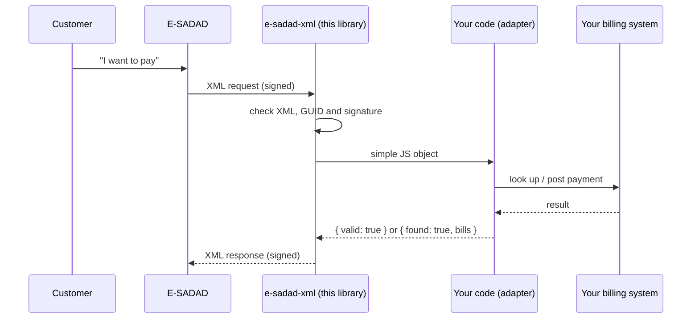

# 1. The big picture

⏱ 3 min · 🎯 You'll learn: who calls whom, and what you actually have to build.

> **TL;DR**
>
> - E-SADAD **calls your server**. You don't call E-SADAD.
> - There are **3 XML calls** plus 1 health check.
> - You answer **2 questions** in your code. The library handles everything else.

---

## 🔁 Who talks to whom



---

## 📞 The 4 calls E-SADAD makes

| #   | Call                           | When                                           | Your code answers                             |
| --- | ------------------------------ | ---------------------------------------------- | --------------------------------------------- |
| 1   | **PrepaidValidation**          | Before a **prepaid** payment, such as a top-up | "Does this customer exist? Is the amount OK?" |
| 2   | **BillPull**                   | Before a **postpaid** payment (bills)          | "What bills does this customer have?"         |
| 3   | **ReceivePaymentNotification** | **After** the customer paid                    | "Post this payment."                          |
| 4   | **Availability**               | Any time (health check)                        | Nothing; the library answers.                 |

💡 **Prepaid only** (like the app top-ups)? You need **1 + 3**.
💡 **Bills only**? You need **2 + 3**.

---

## 🧠 What the library does for you

So you don't have to think about it:

- ✅ Reads and checks the XML
- ✅ Verifies E-SADAD's **signature**, so a fake request is rejected
- ✅ Signs **your** response
- ✅ Logs every request and response, as the integration document requires
- ✅ Never posts the same payment twice, even when E-SADAD retries
- ✅ Formats amounts per currency (JOD `10.000`, ILS `10.00`)
- ✅ Builds correct error responses
- ✅ Hides internal errors from E-SADAD

## ✍️ What you do

1. **Configure:** your biller code, your services and your key files. → [Configuration](03-configuration.md)
2. **Write the adapter:** 2 small functions. → [The adapter](04-adapter.md)
3. **Pick a store:** where logs are saved. → [Database store](07-database-store.md)

That's it.

---

## 📦 How the library is organised (for users)

```
e-sadad-xml             ← main import: EsadadService, helpers, types
e-sadad-xml/express     ← optional: ready-made Express routes
```

Works with:

- **TypeScript** or **JavaScript**
- `import` **or** `require`
- Express (ready-made) or **any** framework (Fastify, NestJS, Koa, plain Node)

---

➡️ **Next:** [2. Quick start](02-quick-start.md)
